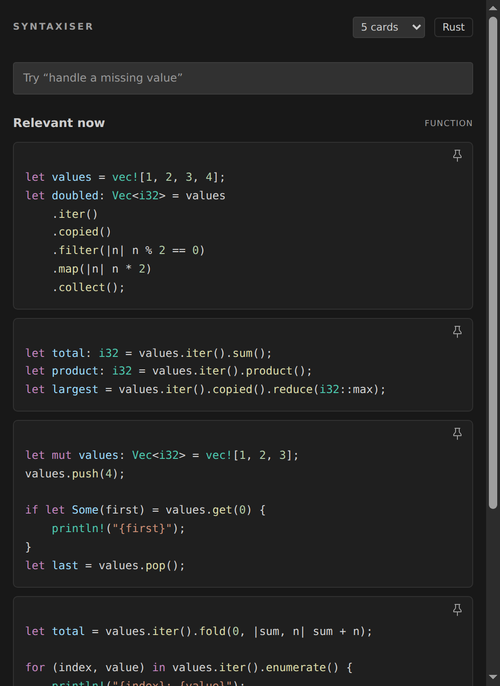
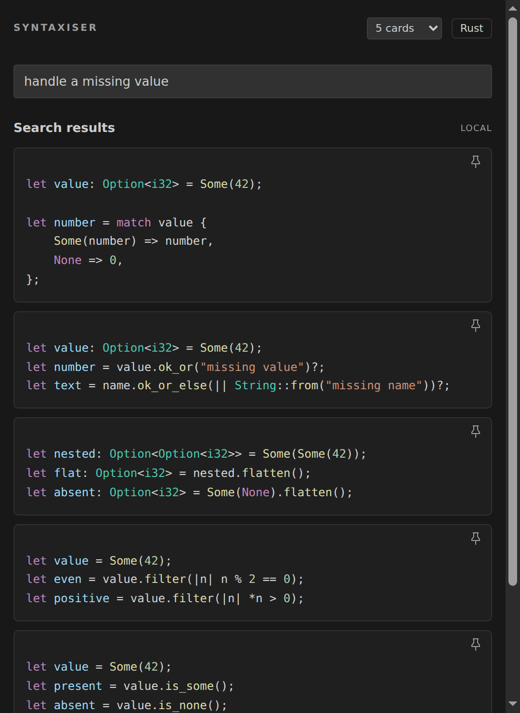
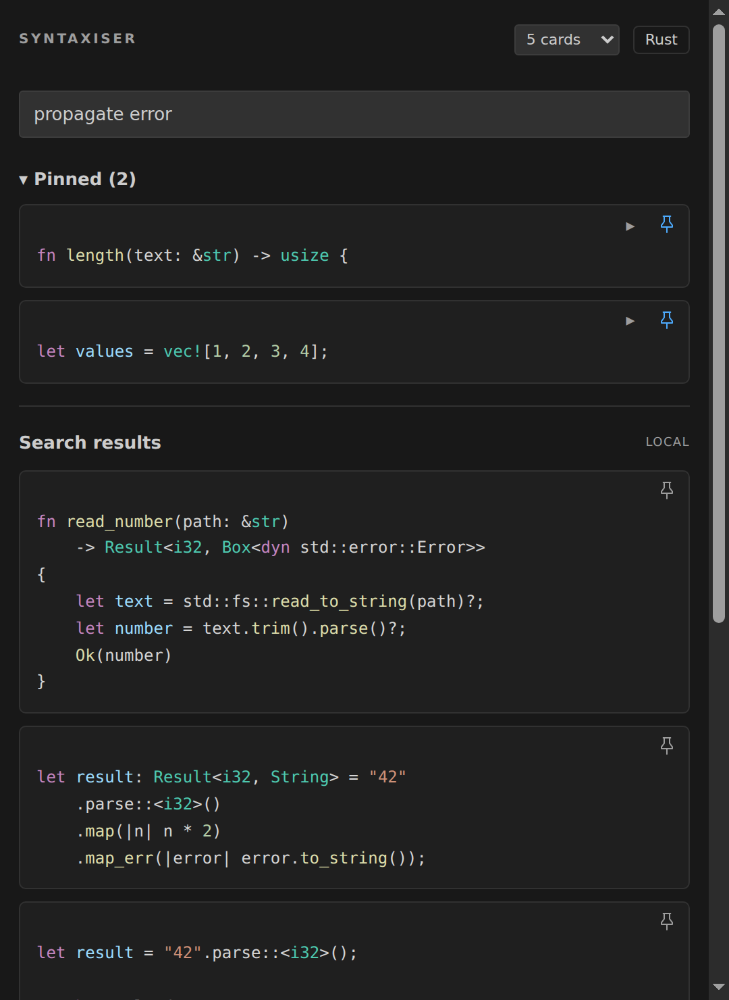

# Syntaxiser

**Learn programming languages while you write code.** Syntaxiser helps you understand unfamiliar syntax, see how it solves real tasks, and build confidence through practice. Its VS Code sidebar brings relevant examples and explorable syntax references beside your work, so you can connect what you're learning to the code in front of you.

Move your cursor to discover examples, search for a task in your own words, open a topic to understand its syntax, and pin useful examples to revisit. See [supported languages and tools](#supported-languages-and-tools) for current coverage.

Everything runs locally: no API key, network requests, telemetry, or language model. Language-server symbols improve context detection when available, but are optional.

| Move your cursor | Search in plain language |
| --- | --- |
| [](docs/screenshots/context.png) | [](docs/screenshots/search.png) |

*Click a screenshot to enlarge it. These captures use the extension's actual sidebar renderer and Rust retrieval results with a dark theme and five cards selected; editor chrome is omitted.*

## Start learning in a minute

Open a supported source file, select the Syntaxiser book icon in the Activity Bar, or run **Syntaxiser: Open Reference** from the Command Palette. Use your own project, or try a short cursor tour: [Rust](examples/context-tour.rs), [Go](examples/context-tour.go), or [TypeScript](examples/context-tour.ts).

1. **Discover an example.** Move onto a declaration, loop, or function call. **Example snippets** changes with the code around your cursor.
2. **Ask about a task.** Search for something you want to do, such as **handle a missing value**. Read a matching snippet and open **ⓘ** for its explanation.
3. **Understand the topic.** Use **↗ Browse reference** on a snippet to explore its syntax forms and rules. Topic overviews and practical examples stay separate, so you can study both the general idea and its application.
4. **Try it yourself.** Adapt the example in your project or a [playground](docs/language-support.md), run it, and change an input or approach to check your understanding. Some snippets need surrounding code or dependencies described in their explanations.
5. **Keep what helps.** Pin an example to revisit during your next task. Clear the search to return to cursor-based suggestions.

Cards show code only. Hover over a snippet or its **ⓘ** button for a short explanation in a styled panel that follows VS Code's theme. Click **ⓘ** to keep it open, or focus the button and press Enter or Space. Close it with Escape, the close button, or a click outside. The panel wraps within the sidebar and opens above the snippet when needed; card dimensions and copied code stay unchanged. The examples are fixed reference snippets; some use illustrative names or require surrounding code and dependencies.

## Understand the syntax behind an example

Each topic in **Reference** includes a **References** list below its syntax and rules, linking to official documentation and other high-quality learning material. Use a contextual snippet's topic link or a quick-reference heading to reach these sources. Rust, Go, JavaScript/JSX, TypeScript (including its libraries), Python, HTML, CSS, and Terminal topics all include links. Browsing and searching remain offline; opening an external source requires internet access.

Choose **Reference** beside **Context** to browse the local catalog for the active language (Rust by default before a supported file is opened). Reference uses left/right panes: the expanded vertical topic list on the left and the syntax overview on the right. Each pane scrolls independently. Type in **Search topics** to filter topic names, area headings, and aliases; Enter opens the first match and Escape clears the filter. The topic search is separate from contextual snippet search. With one topic per row under its area heading, choose a topic for a dedicated quick-reference overview of its syntax forms, variations, and essential rules. These overviews are independently written; contextual snippets remain practical examples of use.

Use a snippet’s **↗ Browse reference** button in contextual results, search results, or pins to explore all the topics it covers. All related overviews appear together. Choose a topic directly from the always-visible tree to open a single overview. Pins remain available alongside the overview. Return to **Context** to resume contextual suggestions or your existing search. The selected mode and topics survive webview reloads.

On **Context**, **Quick reference** shows up to two matching syntax overviews above **Example snippets**. Each preview has an accent edge, a topic link, and three visible lines of syntax; scroll within it to read more, or choose its title to open the full summary, syntax, and rules in Reference. For example, selecting `for` in a loop suggests **Loops**. Context matches use the word under the cursor, current line, and nearby code, and clear when no supported editor is active.

Searching updates both sections for the query: overview matches are ranked independently from practical examples, with at most two previews regardless of your example-card count. Recognized concepts take precedence over incidental mentions in other overviews; queries without recognized concepts can also match overview text. Clearing search restores cursor-based previews. Returning from Reference preserves your search. The previews use the separate overview catalogs and never substitute practical snippets.

## Find an example for your task

Search uses the active language or terminal catalog. For example, try **type guard** in TypeScript, **goroutine** in Go, or **find files** in Terminal. In Rust, you can search by syntax (`split_at_mut`, `sort_by_key`, `get_or_insert_with`) or by the task you're trying to remember:

| Search for | Examples you'll find |
| --- | --- |
| `handle a missing value` | `Option`, `Some` / `None`, `match`, converting to `Result` |
| `read without moving` | Shared references and borrowing with `&str` |
| `change through reference` | `&mut` and mutable borrowing |
| `transform collection` | `.iter()`, `.filter()`, `.map()`, `.collect()` |
| `string arrays` | Fixed arrays of `&str` and `String`, plus initialization with `from_fn` |
| `string vectors` | Growable `Vec<&str>` and `Vec<String>` collections |
| `propagate error` | `Result` and the `?` operator |
| `key value lookup table` | `HashMap`, lookup, and updating entries |
| `read file line by line` | `BufReader` and `.lines()` |
| `stop on first error` | Collecting an iterator into `Result<Vec<_>, _>` |
| `web server` | Axum and Actix Web startup, routing, and server state |

Search replaces the contextual **Example snippets** while the box contains text. Clear it to resume cursor-based suggestions. Queries outside the curated pack may return no cards; try a concept or library name.

## Learn from practical examples

These Rust examples show how to connect a task to its syntax. Use the same approach in any supported language: read an example, open its topic overview, then try a small variation in your own project or a playground.

### Handle an optional value

Search **handle a missing value** when you need to remember the shape of a `match`:

```rust
let value: Option<i32> = Some(42);

let number = match value {
    Some(number) => number,
    None => 0,
};
```

The same search also finds ways to filter an `Option`, flatten nested options, or turn a missing value into an error.

### Borrow a string and keep using it

Search **read without moving** for an example of accepting a shared reference:

```rust
fn length(text: &str) -> usize {
    text.len()
}

let text = String::from("hello");
let size = length(&text);
println!("{text}: {size}");
```

The caller still owns `text` after the function returns. For a function that changes the value, try **change through reference** instead.

### Filter, transform, and collect

Move onto an iterator chain or search **transform collection**:

```rust
let values = vec![1, 2, 3, 4];
let doubled: Vec<i32> = values
    .iter()
    .copied()
    .filter(|n| n % 2 == 0)
    .map(|n| n * 2)
    .collect();
```

This produces `[4, 8]`. Nearby cards cover `fold`, `sum`, `enumerate`, `zip`, and choosing between `iter`, `iter_mut`, and `into_iter`.

### Return early on an error

Search **propagate error** for a function that uses `?` for both file I/O and parsing:

```rust
fn read_number(path: &str)
    -> Result<i32, Box<dyn std::error::Error>>
{
    let text = std::fs::read_to_string(path)?;
    let number = text.trim().parse()?;
    Ok(number)
}
```

For a file containing `42`, this returns `Ok(42)`. A missing file or invalid integer returns an error to the caller.

### Read a file one line at a time

Search **read file line by line** for buffered reading:

```rust
use std::fs::File;
use std::io::{BufRead, BufReader};

let reader = BufReader::new(File::open("input.txt")?);
for line in reader.lines() {
    let line = line?;
    println!("{line}");
}
```

Use this fragment inside a function that returns a compatible `Result`. Related cards cover buffered writing and reading standard input.

### Remember how to start a web server

Search **web server** for Axum and Actix Web alternatives. For example, the Axum card shows a `/health` route:

```rust
use axum::{routing::get, Router};

let app = Router::new()
    .route("/health", get(|| async { "healthy" }));
let listener = tokio::net::TcpListener::bind("127.0.0.1:8080").await?;
axum::serve(listener, app).await?;
```

This fragment needs Axum 0.8, Tokio with the runtime and networking features it uses, and an async function returning a compatible `Result`. The sidebar supplies reference code; add the crates to your own project. More specific searches include **axum json response**, **actix query parameters**, and **request middleware**.

## Keep a small personal reference

Pin a borrowing example and an iterator pipeline, then search **propagate error**. Both pins stay at the top while the search results change:

<a href="https://github.com/sbracegirdle/syntaxiser/blob/main/docs/screenshots/pins.png"></a>

- Click a card's pin icon to keep it; click it again to unpin.
- Use the arrow on a pin to collapse it to its first line, or click **Pinned** to fold the entire group.
- Pins and collapse choices survive cursor movement, searches, and VS Code reloads in the same workspace.
- Choose 5, 12, 20, or 30 initial cards in the header. **Show more** reveals further results, up to sixty; pins have their own space above the list.

## Learn with small challenges

Open **Lesson browser** to explore 12 Rust challenges, 12 Go challenges and 10 Python challenges, progressing from your first greeting to tested command-line projects and concurrency. A difficulty tree on the left lists lesson titles; select one to read its complete task and completion check on the right. The selected lesson is remembered separately for each language. Lessons follow the sidebar's current language context automatically and do not provide solutions. Write your solution in the editor and mark your own progress; Syntaxiser does not execute or grade it.

- Use the single filter row to select difficulty and status. The **↑ / ↓** button switches easiest/hardest first; the **✓** toggle hides completed tasks. Choose the **Done** status filter to see completed tasks again.
- Built-in tasks start untracked in the browser. Click **In progress** while working, **To do** for an upcoming task, or **Done** when satisfied. **Lesson tracker** shows tracked work as cards: In progress first, To do next, and Done last. Difficulty sorting applies within each group. Click the selected status again to stop tracking; the lesson remains available in the browser.
- Status labels, symbols, colored borders, and subtle backgrounds distinguish to-do, in-progress, and completed cards; completed lessons show a green tick.
- Click a lesson's **⊘** button to hide it. Hidden lessons stay out of normal results and completion totals, and remain hidden after reloading. Select **Hidden** in the status filter, then click **↶** to restore a lesson, or choose a new status directly.
- Tracker cards show instructions immediately, with **Show more** for long content. The browser shows the full selected lesson in its scrollable content pane. Status changes, hidden lessons, and personal edits are shared between both tabs.
- **New lesson** needs only a **Title** and **Description**. Include any code or completion check in the description. Your lessons start as **To do**, use a dashed outline and **Your lesson** label, and offer **Edit** and **Delete…** controls. New lessons use the selected difficulty level, or level 1 when all levels are shown. Each language can hold up to 200 custom lessons.
- Progress and custom lessons survive VS Code reloads in the same workspace, separately for each language. Filters and the selected tab are restored when the sidebar reopens.
- **Reset this language…** or **Reset all languages…** asks whether to reset progress alone or also remove custom lessons. Resetting does not change reference-card pins.

For a manual check, select a Rust lesson in the browser and mark it in progress. Switch to the tracker and confirm its card appears. Add another To do task, then switch to a Go file and select a different lesson. Reload and confirm each language retains its browser selection and progress. Create a personal lesson, try the filters and hidden recovery, cancel a reset, then reset one language and confirm the other is unchanged.

## Supported languages and tools

- **Rust** — core syntax and common libraries.
- **Go** — core language syntax and database clients.
- **JavaScript / JSX** — language fundamentals, React, and Node libraries.
- **TypeScript / TSX** — fundamentals and popular libraries.
- **Python** — fundamentals and common libraries.
- **HTML and CSS** — markup, styling, Bootstrap, and Tailwind.
- **SQL** — SQLite and PostgreSQL queries.
- **Developer terminals** — shell commands, Git, Cargo, Go, Node/TypeScript tooling, and AWS CLI.

See [coverage, playgrounds, and setup notes](docs/language-support.md) for details.

## Install from source

Requires VS Code 1.93 or newer, plus Node for building the package. The Node version is recorded in [.nvmrc](.nvmrc).

```sh
git clone https://github.com/sbracegirdle/syntaxiser.git
cd syntaxiser
nvm install
nvm use
pnpm install
pnpm package
```

In VS Code, run **Extensions: Install from VSIX…** and select the generated `syntaxiser-0.4.3.vsix`. Open a supported source file and run **Syntaxiser: Open Reference**. When updating an installed version, accept the reload prompt.

## Settings

The default is twelve cards per section, with updates after a 350 ms pause in cursor movement or edits.

```json
{
  "syntaxiser.maxCards": 5,
  "syntaxiser.debounceMs": 350
}
```

| Setting | Default | Range |
| --- | --- | --- |
| `syntaxiser.maxCards` | 12 | 3–30 initial cards; Show more reveals additional cards |
| `syntaxiser.debounceMs` | 350 | 100–2000 ms |

The card-count menu saves to the existing setting's scope, or to user settings when there is no override. Settings follow the active document, including workspace-folder and language overrides.

## Develop and contribute

Add this project folder to your existing VS Code workspace. After installing dependencies, run `pnpm test`, select **Run Syntaxiser** in Run and Debug, and press F5 to open the Extension Development Host with the tour file.

The test suite covers retrieval, scope scanning, controller events, rendering, search, pins, paging, settings, and syntax highlighting. With `rustfmt` installed, `pnpm check:rust` also parses the reference cards as Rust fragments.

See [how Syntaxiser works](docs/how-it-works.md) for ranking, offline behavior, accessibility, implementation limits, adding a language, and validation details. To extend the learning material, keep topic syntax/API overviews separate from practical task examples and validate both against the language or library they teach. The contextual examples live in [packs/rust.json](packs/rust.json), [packs/go.json](packs/go.json), and [packs/typescript.json](packs/typescript.json); [THIRD_PARTY_NOTICES.md](THIRD_PARTY_NOTICES.md) covers bundled highlighting licenses.

Licensed under [MIT](LICENSE).

## Public website (local preview)

The learning-focused landing page lives in [website/](website/README.md). Preview it with `pnpm dlx http-server@14.1.1 website -a 127.0.0.1 -p 4188 -c-1`, then open `http://127.0.0.1:4188`. It includes examples, sidebar screenshots, and source installation instructions. It has not been deployed and is excluded from the extension package.
